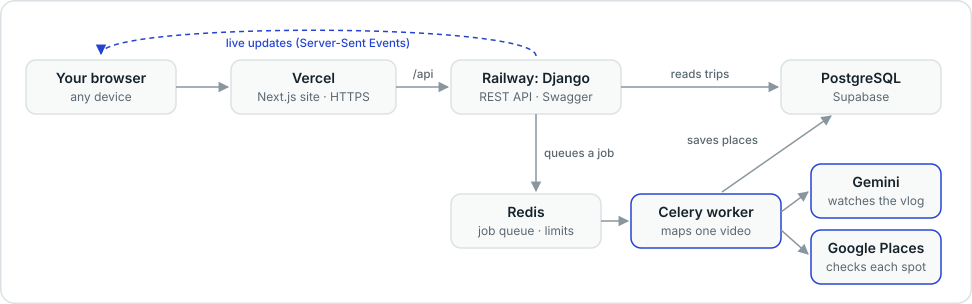

# 🗺️ AfterFrame

Paste a YouTube travel vlog and get a map of every place in it, each pinned at the moment it shows up in the video.

👉 **Try it:** [afterframe-ten.vercel.app](https://afterframe-ten.vercel.app)

<!-- Screenshot: save a trip page screenshot as docs/screenshot.png, then replace this comment with:
 -->

## ✨ What it does

- 🎬 Gemini watches the vlog straight from its YouTube link (no downloads, no scraping)
- 📍 Every place is checked on Google Maps and marked Verified, Needs review or Unmatched
- ⚡ Pins appear on the map live, while the video is still being processed (~15–35 s)
- ▶️ Click a pin to jump to that exact moment in the video

## ⚙️ How it works



1. The YouTube Data API checks the video is public and under 30 minutes
2. Gemini (`gemini-3.5-flash-lite`) lists every place with a category, timestamp and short description
3. Each place gets one Google Places search; if that isn't a confident match, a small LangGraph agent searches a little more (2 searches max)
4. A plain score in code (70% name match, 30% location) decides the label
5. Places are saved one by one and streamed to the page over Server-Sent Events

## 🧱 Tech stack

**Frontend:** Next.js 16 · React 19 · TypeScript · Tailwind CSS 4 · Google Maps JS API<br>
**Backend:** Django 6.1 · Django REST Framework · Celery · Redis · PostgreSQL<br>
**AI:** Gemini · LangGraph<br>
**Hosting:** Vercel · Railway · Supabase

## 💡 A few details

- 💸 About ₹1.5–3 of Gemini per vlog, and a site-wide limit of 10 new videos a day
- 🪶 The whole backend runs in about 340 MB of RAM: one web process and one worker
- 🐛 Under ASGI, Django was opening a new Redis connection on every request. Sharing one connection pool cut API calls from ~2 s to under 1 s

## 💻 Run it locally

You'll need Docker, Python 3.14 with [uv](https://docs.astral.sh/uv/), Node 24, and Google API keys: Gemini, Places + YouTube Data, and Maps JS.

```bash
# Postgres + Redis
docker compose -f deploy/docker-compose.dev.yml up -d

# API: copy the env file, add your keys to it, then run
cd backend && cp .env.example .env && uv sync
uv run python manage.py migrate
uv run gunicorn config.asgi:application -k uvicorn_worker.UvicornWorker -b 127.0.0.1:8000

# Worker (second terminal, in backend/)
uv run celery -A config worker -B

# Website (third terminal, from the repo root): add the Maps key and Map ID to .env.local
cd frontend && cp .env.example .env.local && npm install
npm run dev    # http://localhost:3000
```

Deployment notes are in [deploy/README.md](deploy/README.md).

---

Made by [Khushboo Malik](https://www.linkedin.com/in/khushboo-malik01/) 👋
