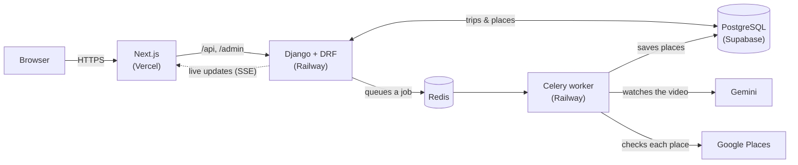

# AfterFrame

**Paste a YouTube travel vlog. Get a map of every place in it, each pinned at the moment it appears in the video.**

**Live:** [afterframe-ten.vercel.app](https://afterframe-ten.vercel.app) · [How it works](https://afterframe-ten.vercel.app/how-it-works)

<!-- Screenshot: save a trip page screenshot as docs/screenshot.png, then replace this comment with:
 -->

## What it does

- **Paste a public YouTube link.** Watch, youtu.be, Shorts and mobile links all work, for videos up to 30 minutes.
- **The AI watches the video itself.** Gemini reads the video straight from its YouTube link and lists every place, with a category, the timestamp it appears at and a short description.
- **Every place is checked against Google Maps.** It gets one direct Google Places search. If that doesn't give a confident match (think "a tiny fado bar near the castle"), a small AI agent searches further. Each place ends up **Verified**, **Needs review** or **Unmatched**.
- **Pins appear live.** Places stream onto the map in the order the vlogger visits them, while the video is still being processed. A typical vlog takes about 15–35 seconds.
- **Every stop opens the video at that moment.** Click a pin to see Google's place card (photo, rating), the description, and a timestamp that opens the vlog right there.
- **Mapped trips are saved.** Reopening one loads instantly from the database and costs nothing.

## How it works



The worker runs this pipeline for each new video:

1. **Validate.** The YouTube Data API confirms the video is public and no longer than 30 minutes.
2. **Watch.** Gemini (`gemini-3.5-flash-lite`) watches the video from its URL and streams out structured places.
3. **Look up.** Each place gets one direct Google Places (New) Text Search.
4. **Ask the agent.** Places the direct search can't verify go to a LangGraph agent: Gemini with a search tool, capped at 2 searches and 4 turns, and at most 6 places per video.
5. **Label.** Code, not the model, scores each match: 70% name similarity, 30% whether the address matches the city or country. The score decides Verified, Needs review or Unmatched.
6. **Stream.** Each place is saved as soon as it's resolved. The trip page receives it over Server-Sent Events, and falls back to polling if the stream can't connect.

## Engineering notes

- **No scraping, no downloads.** Everything goes through official Google APIs: the YouTube Data API checks the video, Gemini reads it from its link, and Google Places confirms each location.
- **AI where it helps, code where it can be checked.** The agent only runs when a direct search can't verify a place, with hard caps on searches and turns. The final Verified / Needs review / Unmatched label comes from a deterministic score in code.
- **Cost guard rails.**
  - 10 new videos per day across the whole site, counted in Redis.
  - A 30-minute video cap.
  - At most 26 Places searches per video.
  - Already-mapped trips are served from the database.
  - In test runs, a vlog cost about ₹1.5–3 (≈ $0.02–0.03) in Gemini usage.
- **Small footprint.**
  - Production runs one ASGI web process (gunicorn + uvicorn) and one Celery worker. The worker maps one video at a time and runs the daily jobs itself.
  - Measured at about 340 MB of RAM in total, sized to fit Railway's $5 Hobby plan.
- **Google data handled by the rules.** Ratings and photos are never stored: Google's own place card shows them live. Google's terms require stored coordinates and addresses to be refreshed within 30 days, so a daily job re-reads any older than 29 days.
- **A production bug, measured and fixed.**
  - Under ASGI, Django creates a cache object per request, and its Redis backend built a new connection pool for each one. Every rate-limited API call therefore opened a fresh Redis connection.
  - On Railway's private network that added about 1.2 s per request.
  - A connection pool shared per process (`backend/config/redis_pool.py`) took API calls from about 2.0 s to under 1 s.
- **Curated front page.** Only trips the owner marks as featured in `/admin` appear on the home page and `/trips`. Every trip still opens at its own link.

## Tech stack

| Area | Tools |
|---|---|
| Frontend | Next.js 16 (App Router, Cache Components), React 19, TypeScript, Tailwind CSS 4, Google Maps JavaScript API (`@vis.gl/react-google-maps`), Places UI Kit |
| Backend | Python 3.14, Django 6.1, Django REST Framework, drf-spectacular (OpenAPI / Swagger), Celery, Redis, gunicorn + uvicorn (ASGI), uv |
| AI | Gemini via `google-genai`, LangGraph agent with `langchain-google-genai`, optional LangSmith tracing |
| Google APIs | YouTube Data API v3, Places API (New) |
| Data and hosting | PostgreSQL on Supabase; Railway (web, worker, Redis); Vercel; Docker; GitHub Actions |

## Run it locally

**You need:**
- Docker
- Python 3.14 with [uv](https://docs.astral.sh/uv/)
- Node.js 24
- These Google keys:
  - A Gemini API key from Google AI Studio.
  - A server key with **Places API (New)** and **YouTube Data API v3** enabled.
  - A browser key for the **Maps JavaScript API** and **Places UI Kit**, plus a Map ID.

```bash
# 1. Postgres (localhost:55432) and Redis (localhost:56379)
docker compose -f deploy/docker-compose.dev.yml up -d

# 2. Backend API
cd backend
cp .env.example .env          # add GEMINI_API_KEY and GOOGLE_SERVER_API_KEY
uv sync
uv run python manage.py migrate
uv run python manage.py createsuperuser        # optional, for /admin
uv run gunicorn config.asgi:application -k uvicorn_worker.UvicornWorker -b 127.0.0.1:8000

# 3. Worker (second terminal, in backend/)
uv run celery -A config worker -B --loglevel INFO

# 4. Frontend (third terminal)
cd frontend
cp .env.example .env.local    # add the Maps browser key and Map ID
npm install
npm run dev                   # http://localhost:3000
```

Use gunicorn with the uvicorn worker, as above, rather than `manage.py runserver`. `runserver` buffers the live updates.

The API docs (Swagger) are at `http://localhost:8000/api/docs`.

Handy commands (run in `backend/`; none of the `try_ai` ones write to the database):

```bash
uv run python manage.py try_ai extract <youtube-url>    # what Gemini finds, with token cost
uv run python manage.py try_ai pipeline <youtube-url>   # the full watch → look up → agent → label run
uv run python manage.py seed_examples <url> [<url> ...] # map example trips, skipping the daily limit
```

## Project structure

```
backend/
  core/      Gemini extraction, the LangGraph agent, place matching, YouTube checks (plain Python)
  trips/     Django app: models, REST API, live stream (SSE), Celery tasks, daily limit
  config/    settings, Celery app, URLs
  Dockerfile production image (web and worker)
frontend/
  app/        routes: home, /trips, /v/[videoKey] (the trip map), /how-it-works
  components/ map, stop panel, loading scene, header and footer
deploy/      production runbook (Railway + Vercel + Supabase) and the local Docker Compose file
.github/     CI (Django check + Next.js build) and a daily database keep-alive
```

## Deployment

The frontend is deployed on Vercel from `frontend/`. The backend image (`backend/Dockerfile`) runs on Railway as two services, `web` and `worker`, next to a Railway Redis. PostgreSQL is on Supabase. Settings, variables and one-off commands are in [deploy/README.md](deploy/README.md).

## What's next

- **Accuracy evals:** precision, recall and timestamp error on 8 hand-labelled vlogs. Results will go on the How it works page.
- **Instagram Reels:** links are recognised today, and the site answers "coming soon".

## Credits

Maps and place cards © Google. Video thumbnails and links © their YouTube creators. Fonts: Fraunces and Inter (SIL Open Font License). See [frontend/CREDITS.md](frontend/CREDITS.md).

---

Built by [Khushboo Malik](https://www.linkedin.com/in/khushboo-malik01/).
